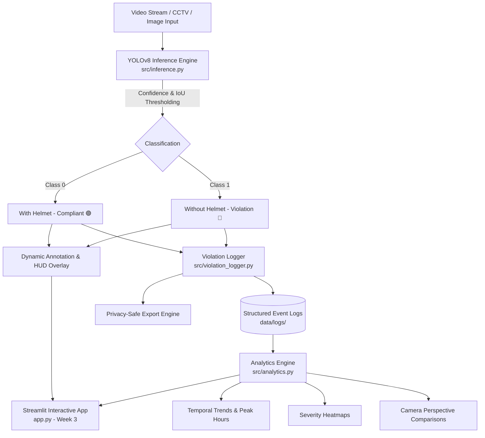

# Helmet & Rider-Safety Violation Detection with Analytics

> **Trackgenesis Data Science & Data Analytics + AI/ML Internship – Combined Batch (Oct 2026)**  
> **Project 5: Automated Real-Time Two-Wheeler Safety Violation Detection, Temporal Analytics & Compliance Dashboard**

---

## 📌 Executive Summary
Road safety and traffic enforcement are urgent priorities on Indian roads, especially in high-density two-wheeler traffic hubs like Kerala. Rather than relying on static image classification or manual traffic police monitoring, this project implements an end-to-end AI/ML and Data Analytics system that:
1. **Detects Safety Violations in Real Time:** Identifies motorcycle and scooter riders as well as pillion passengers traveling without helmets using fine-tuned Ultralytics YOLOv8 models.
2. **Maintains a Structured Event Log:** Records timestamps, camera IDs, detection confidences, and rider counts for every violation event.
3. **Delivers Temporal Analytics & Heatmaps:** Generates actionable compliance insights, peak violation windows, and multi-camera angle comparisons.
4. **Ensures Privacy-by-Design:** Aggregates enforcement statistics without storing facial biometrics, driver identities, or vehicle license plates.

---

## 🏗️ System Architecture



---

## 🗓️ Project Roadmap & Milestones

| Timeline | Focus Area | Status | Key Deliverables |
| :--- | :--- | :---: | :--- |
| **Week 1** | **Data Audit & Baseline Model** | ✅ **Completed** | • Pascal VOC annotation audit and coordinate bug fix (`/1000` fix for 17 corrupted XML boxes)<br/>• YOLO format dataset formatting (70/20/10 split)<br/>• Baseline YOLOv8n training for 50 epochs on Colab GPU (`mAP@50 = 87.59%`) |
| **Week 2** | **Violation Logging & Analytics Core** | ✅ **Completed** | • Structured violation event schema (`src/violation_logger.py`)<br/>• Temporal analytics, peak hours & severity heatmaps (`src/analytics.py`)<br/>• Real-time inference pipeline with color-coded HUD rendering (`src/inference.py`)<br/>• Data augmentation strategy to boost violation recall |
| **Week 3** | **Interactive Streamlit MVP** | ✅ **Completed** | • Streamlit application (`app.py`) with live webcam / video inference<br/>• Dynamic sensitivity tuning (confidence and IoU threshold sliders)<br/>• Real-time violation event log table with privacy-safe CSV download<br/>• Merged Plotly visualizer (Hourly trends, camera angle comparison, 2D severity heatmap) |
| **Week 4** | **Temporal Dashboard & Final Demo** | ✅ **Completed** | • Automated Zero-PII privacy compliance audit suite (`scripts/run_privacy_audit.py`)<br/>• Privacy compliance certificate & report (`docs/PRIVACY_COMPLIANCE_AUDIT.md`)<br/>• Comprehensive model benchmark report & charts (`docs/FINAL_BENCHMARK_REPORT.md`)<br/>• Final demo walkthrough script & presentation deck (`docs/PRESENTATION_SLIDES.md`) |

---

## 📂 Project Directory Structure

```
helmet-safety-project/
│
├── Instruction/
│   └── Project_Instruction.pdf           # Official Trackgenesis project guidelines
│
├── data/
│   ├── README.md                          # Dataset documentation & annotation audit report
│   └── logs/                              # Audit event ledgers & privacy-safe CSV summaries
│
├── docs/
│   ├── PRIVACY_COMPLIANCE_AUDIT.md        # Formal Zero-PII privacy governance report
│   ├── FINAL_BENCHMARK_REPORT.md          # Multi-model benchmarks, PR curves & latency
│   ├── FINAL_DEMO_WALKTHROUGH.md          # 5-minute timed video demo & recording guide
│   └── PRESENTATION_SLIDES.md             # Complete presentation slide deck outline
│
├── models/
│   ├── README.md                          # Model architectures, benchmarks & fine-tuning config
│   ├── baseline_yolov8n.pt                # Baseline trained weights
│   └── best.pt                            # Fine-tuned 2-class production model weights
│
├── notebooks/
│   ├── InternshipProjectHelmetDetection_ (1).ipynb   # Week 1: EDA, annotation audit & YOLO formatting
│   ├── HelmetSafety_yolov8 (4).ipynb                 # Week 1: YOLOv8 baseline training & test eval
│   └── helmetsafety-yolov8-finetuned.ipynb           # Week 2: Fine-tuning, 4-way augmentation benchmarks & sliders
│
├── reports/
│   └── figures/                           # Exported interactive HTML & SVG benchmark charts
│
├── scripts/
│   ├── run_privacy_audit.py               # Automated Zero-PII compliance audit suite
│   └── export_benchmark_charts.py         # PR curve & confusion matrix chart generator
│
├── src/
│   ├── violation_logger.py                # Structured event logging & privacy export
│   ├── analytics.py                       # Temporal trends, heatmaps, shifts & Plotly charts
│   └── inference.py                       # Real-time detection, dynamic HUD & threshold tuning
│
├── app.py                                 # Streamlit UI dashboard (Week 3/4 milestone)
├── requirements.txt                       # Python dependencies
└── README.md                              # Main project documentation
```

---

## 📊 Week 1 Baseline Evaluation Insights

From the held-out test split evaluation (77 images, 156 instances) in `HelmetSafety_yolov8 (4).ipynb`:

- **Overall mAP@50:** `87.59%`
- **Overall mAP@50-95:** `52.06%`
- **Precision:** `84.11%`
- **Recall:** `79.10%`

### Per-Class Performance
| Class Name | Instances | Precision | Recall | mAP@50 | Status |
| :--- | :---: | :---: | :---: | :---: | :---: |
| **With Helmet** | 89 | 85.9% | 88.8% | 91.6% | Strong detection |
| **Without Helmet** *(Violation)* | 67 | 82.3% | **69.4%** | 83.6% | **Target for Week 2 Tuning** |

> **Diagnostic Finding:**  
> The lower recall for the violation class (69.4%) indicates that approximately 3 out of 10 unhelmeted riders are currently missed by the baseline model, primarily due to distant pillion riders, low contrast shadows, and helmet-like hairstyles. Week 2 fine-tuning introduces targeted augmentations (Mosaic, Mixup, HSV brightness jitter) to close this recall gap.

---

## ⚙️ Module Usage & Verification

### 1. Structured Violation Logging (`src/violation_logger.py`)
Records detection events into standardized schemas and generates anonymized summary tables:
```python
from src.violation_logger import ViolationLogger

logger = ViolationLogger(log_dir="data/logs")

# Log detections from a video frame
logger.log_detection(
    frame_id=102,
    detections=[
        {"class_id": 1, "class_name": "Without Helmet", "confidence": 0.88},
        {"class_id": 0, "class_name": "With Helmet", "confidence": 0.94}
    ],
    camera_id="CAM-Kochi-MG-Road"
)

# Export logs
logger.to_csv("data/logs/daily_violations.csv")
logger.generate_privacy_safe_export("data/logs/privacy_report.csv")
```

### 2. Temporal Analytics & Visualizations (`src/analytics.py`)
Computes KPIs, peak violation hours, and generates interactive Plotly figures:
```python
import pandas as pd
from src.analytics import ViolationAnalytics

df = pd.read_csv("data/logs/sample_violation_logs.csv")
analytics = ViolationAnalytics(df)

# Executive KPIs
kpis = analytics.get_summary_kpis()
print(f"Peak Violation Hour: {kpis['peak_violation_hour']}")
print(f"Overall Compliance: {kpis['overall_compliance_rate_pct']}%")

# Generate Interactive Plotly figures
fig_hourly = analytics.plot_hourly_trends()
fig_heatmap = analytics.plot_severity_heatmap()
fig_camera = analytics.plot_camera_comparison()
```

### 3. Real-Time Inference & Dynamic HUD (`src/inference.py`)
Runs YOLO inference with real-time threshold sliders and color-coded bounding boxes:
```python
import cv2
from src.inference import HelmetDetector
from src.violation_logger import ViolationLogger

detector = HelmetDetector(
    model_path="models/baseline_yolov8n.pt",
    conf_threshold=0.35,
    iou_threshold=0.45
)
logger = ViolationLogger()

# Process single frame or stream
frame = cv2.imread("sample_traffic.jpg")
annotated_frame, detections, record = detector.process_frame(
    frame, frame_id=1, logger=logger, camera_id="CAM-Trivandrum-01"
)
```

---

## 🔒 Privacy & Ethical Governance
To prevent surveillance abuse and comply with modern data privacy frameworks:
- **No License Plate Recognition (ALPR):** License plates are neither bounded nor stored.
- **Zero Facial Data Retention:** No facial crops, identity features, or biometric embeddings are collected.
- **Aggregated Reporting:** All public or exported reports are strictly aggregated into hourly/daily violation totals and compliance rates.

---

## 🚀 Setup & Installation

```bash
# 1. Clone repository
git clone <repo-url>
cd helmet-safety-project

# 2. Create and activate a virtual environment (optional but recommended)
python -m venv venv
venv\Scripts\activate      # Windows

# 3. Install dependencies
pip install -r requirements.txt
```
