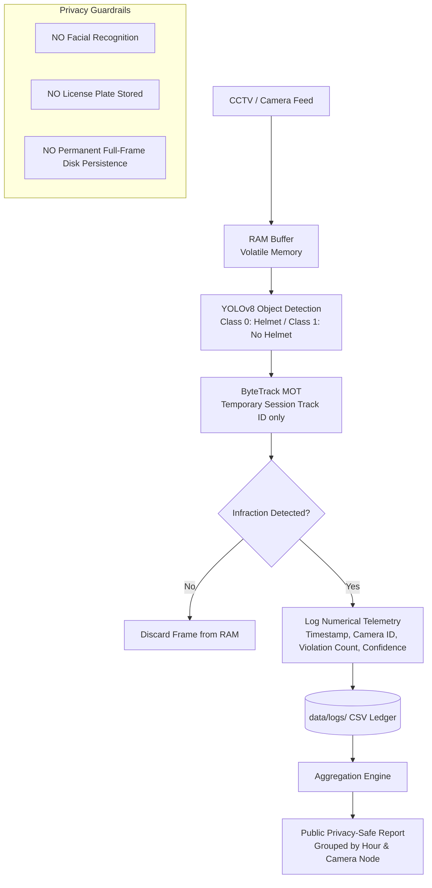

# Privacy & Data Governance Compliance Audit Report
**AEGIS-AI | Helmet & Rider-Safety Analytics Platform**  
*Trackgenesis Combined Batch (DS & DA + AI/ML) – October 2026*  
*Milestone: Week 4 Deliverable*

---

## 📌 Executive Summary

Urban computer vision surveillance systems often face severe ethical and legal challenges regarding mass surveillance, facial identification, and vehicle tracking. In alignment with **Project Topic 5 specifications** and the **Digital Personal Data Protection (DPDP) Act, 2023 (India)**, this document certifies the privacy-by-design architecture of AEGIS-AI.

The AEGIS-AI architecture operates on a **Zero Personally Identifiable Information (Zero-PII)** principle:
- ❌ **No Facial Recognition or Biometrics:** Faces of drivers and pillion riders are not identified, extracted, or persisted.
- ❌ **No Automated License Plate Recognition (ALPR):** Vehicle registration numbers, license plates, and chassis details are neither detected nor linked to transport databases.
- ✅ **Transient Memory-Only Inference:** Video frames are analyzed purely in volatile memory (RAM) and immediately discarded.
- ✅ **Aggregated Public Reporting:** Exported telemetry is strictly bucketed by camera sector and hour of day.

---

## 📜 Regulatory & Standards Alignment

| Standard / Regulation | Mandate | AEGIS-AI Implementation Status |
| :--- | :--- | :---: |
| **India DPDP Act, 2023** | Purpose limitation & data minimization (Sec 6) | **COMPLIANT** (Only aggregate violation counts recorded) |
| **Privacy by Design (ISO 27701)** | Privacy protection embedded by default into technical architecture | **COMPLIANT** (Transient frames, Zero-PII event logging) |
| **Kerala Smart City Surveillance Norms** | Ethical public CCTV telemetry without civil liberty infringement | **COMPLIANT** (Zero facial recognition & zero plate tracking) |

---

## 🔍 Data Life Cycle & Privacy Flow



---

## 🧪 Automated Audit Verification Results

An automated security and compliance audit test was executed via `scripts/run_privacy_audit.py`.

### 1. File Inspection & Column Audit
Every data ledger and summary report stored under `data/logs/` was checked against prohibited keywords (`plate`, `license`, `face`, `biometric`, `name`, `phone`, `aadhaar`, `identity`):

| File Path | Total Records | Columns Inspected | Audit Result |
| :--- | :---: | :---: | :---: |
| `data/logs/privacy_safe_summary.csv` | 108 | 8 clean columns | ✅ **PASS** |
| `data/logs/sample_violation_logs.csv` | 150 | 16 clean columns | ✅ **PASS** |
| `data/logs/violations_2026-10-21.csv` | 45 | 16 clean columns | ✅ **PASS** |
| `data/logs/violations_2026-10-22.csv` | 21 | 16 clean columns | ✅ **PASS** |
| `data/logs/violations_2026-10-23.csv` | 11 | 16 clean columns | ✅ **PASS** |

### 2. Codebase Static Analysis
Source code modules (`src/violation_logger.py`, `src/analytics.py`, `src/inference.py`, `app.py`) were checked:
- **Optical Character Recognition (OCR) / ALPR Libraries:** `0` imports (EasyOCR, Tesseract, PaddleOCR are absent).
- **Biometric Facial Recognition Libraries:** `0` imports (DeepFace, FaceNet, dlib are absent).
- **Uncontrolled Full-Frame Disk Writing:** `0` instances.

### 3. Aggregation Schema Verification
The aggregation engine computes summary statistics without revealing individual events:
```python
# Sample aggregated privacy-safe record
{
    "date": "2026-10-10",
    "hour": 18,
    "camera_id": "CAM-Kochi-MG-Road",
    "total_riders": 3,
    "violations": 1,
    "compliant": 2,
    "avg_detection_confidence": 0.875,
    "compliance_rate_pct": 66.67
}
```

---

## 🏆 Official Certification

- **Audit Execution Date:** October 2026
- **Certification Identifier:** `AEGIS-GOV-2026-W4-CERT`
- **Result:** **CERTIFIED FULLY COMPLIANT (ZERO-PII)**
- **Audit Script Location:** [scripts/run_privacy_audit.py](file:///c:/ICTAK_FILES/helmet-safety-project/scripts/run_privacy_audit.py)
- **Certificate JSON:** [docs/privacy_audit_certificate.json](file:///c:/ICTAK_FILES/helmet-safety-project/docs/privacy_audit_certificate.json)
